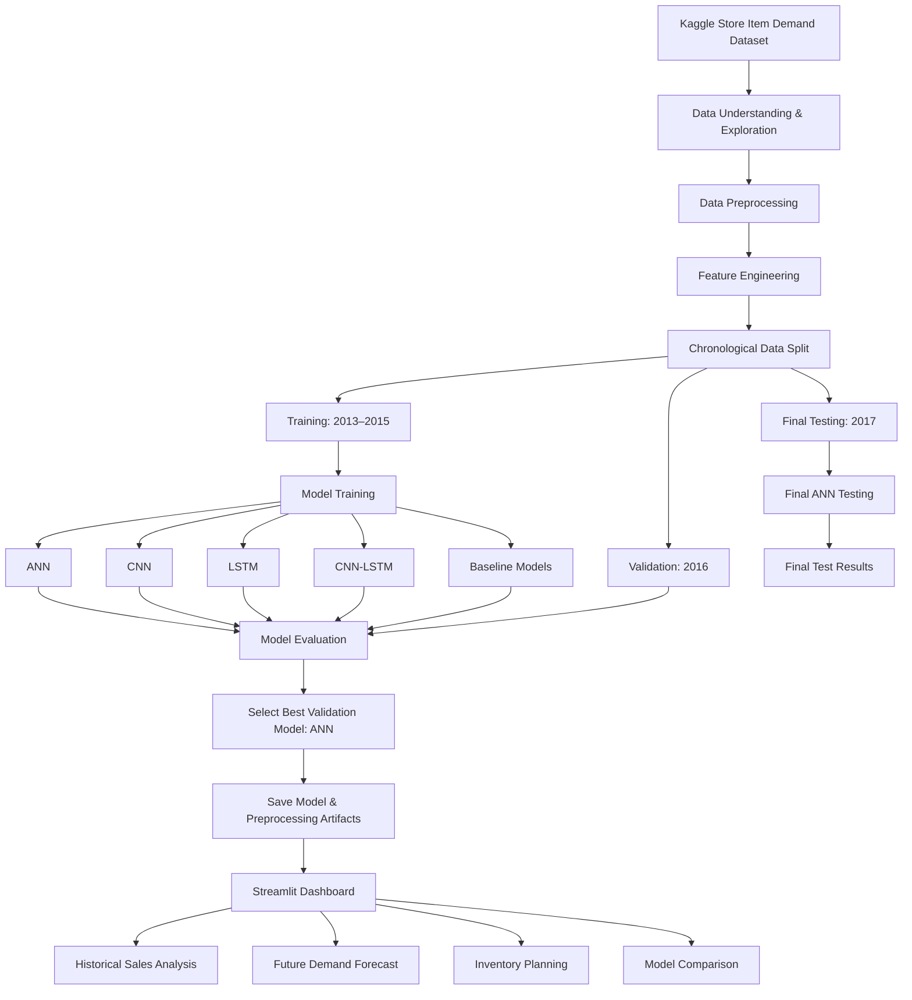
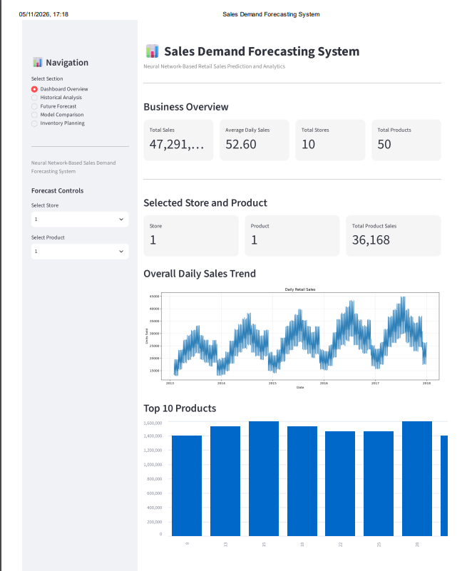
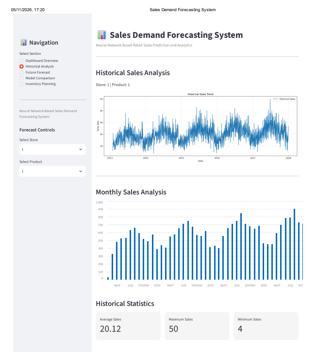
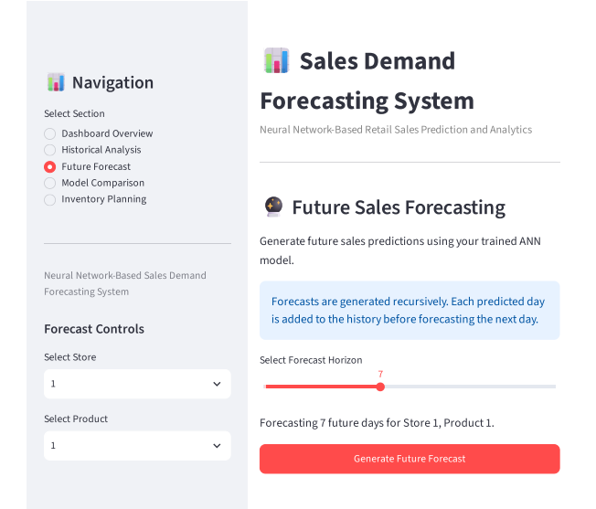
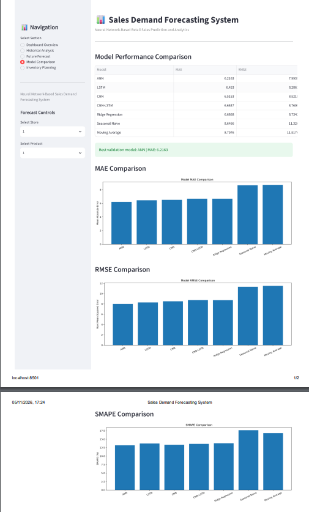
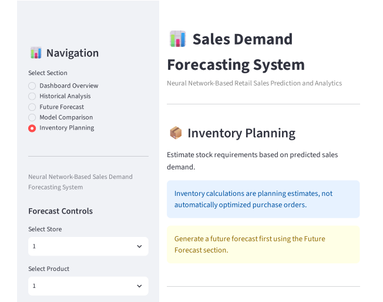

# Neural Network-Based Sales Demand Forecasting System

A deep learning-based sales forecasting project that predicts future product demand using historical sales data. The project compares multiple machine learning and neural network models and provides an interactive Streamlit dashboard for sales analysis, forecasting, and inventory planning.

## 1. Project Overview

Accurate sales forecasting helps businesses maintain sufficient inventory, reduce overstocking, prevent stockouts, and improve business decisions.

This project uses historical sales information to predict future daily demand for different stores and items. It implements and compares traditional machine learning approaches, baseline forecasting methods, and deep learning architectures.

The project also includes an interactive dashboard developed using Streamlit.

## 2. Objectives

- Analyse historical store and item-level sales data.
- Perform data cleaning and preprocessing.
- Create useful features such as lag values, rolling averages, and date-based features.
- Develop and train multiple forecasting models.
- Compare model performance using MAE, RMSE, and SMAPE.
- Predict future sales using the selected model.
- Provide an interactive dashboard for sales analysis and inventory planning.

## 3. Technologies Used

| Technology | Purpose |
|---|---|
| Python | Main programming language |
| PyTorch | Neural network development |
| Pandas | Data manipulation |
| NumPy | Numerical operations |
| Scikit-learn | Preprocessing and evaluation |
| Matplotlib | Data visualisation |
| Jupyter Notebook | Model development and experiments |
| Streamlit | Interactive dashboard |

## 4. Dataset

The project uses the **Store Item Demand Forecasting Challenge** dataset.

The dataset contains daily sales records for different stores and items.

Main columns:

- `date` – Date of the sales record
- `store` – Store identifier
- `item` – Item identifier
- `sales` – Number of units sold

### Dataset Download

The dataset is available on Kaggle:

https://www.kaggle.com/competitions/demand-forecasting-kernels-only/data

Download `train.csv` and place it inside:

```text
data/raw/train.csv
```

**Important:** The raw dataset is not included in this GitHub repository. Users must download it themselves and follow the dataset provider's terms and conditions.

## 5. Project Architecture

```text
sales-demand-forecasting/
│
├── app/
│   ├── pages/
│   ├── dashboard.py
│   ├── forecasting.py
│   ├── model_loader.py
│   └── prediction.py
│
├── data/
│   ├── raw/
│   └── processed/
│
├── models/
│   ├── ann_model.pth
│   ├── cnn_model.pth
│   ├── lstm_model.pth
│   └── cnn_lstm_model.pth
│
├── notebooks/
│   ├── 01_data_understanding.ipynb
│   ├── 03_data_preprocessing.ipynb
│   ├── 05_baseline_models.ipynb
│   ├── 06_ann_model.ipynb
│   ├── 07_cnn_model.ipynb
│   ├── 08_lstm_model.ipynb
│   ├── 09_cnn_lstm_model.ipynb
│   ├── 10_final_model_evaluation.ipynb
│   └── 11_final_testing.ipynb
│
├── reports/
│   ├── figures/
│   ├── final_test_results.csv
│   ├── model_comparison.csv
│   └── other evaluation files
│
├── src/
├── tests/
├── requirements.txt
├── check_environment.py
└── README.md
```


## 6. Models Implemented

The following approaches were developed and evaluated:

1. Seasonal Naive Forecasting
2. Moving Average
3. Ridge Regression
4. Artificial Neural Network (ANN)
5. Convolutional Neural Network (CNN)
6. Long Short-Term Memory (LSTM)
7. CNN-LSTM Hybrid Model

The models use historical sales patterns and engineered features to estimate future demand.

## 7. Model Evaluation

The dataset was divided chronologically to avoid using future information during training.

| Dataset | Period |
|---|---|
| Training | 2013–2015 |
| Validation | 2016 |
| Final Testing | 2017 |

### Validation Results

| Model | MAE | RMSE | SMAPE |
|---|---:|---:|---:|
| ANN | 6.2163 | 7.9939 | 13.2032% |
| LSTM | 6.4530 | 8.2861 | 13.7254% |
| CNN | 6.5153 | 8.5219 | 13.3650% |
| CNN-LSTM | 6.6847 | 8.7609 | 13.6205% |
| Ridge Regression | 6.6868 | 8.7342 | 13.8069% |
| Seasonal Naive | 8.6466 | 11.3260 | 17.6409% |
| Moving Average | 8.7076 | 11.5176 | 16.7837% |

**ANN achieved the best validation performance** among the evaluated models.

### Final Test Result

The selected ANN model was evaluated on unseen 2017 data.

| Metric | ANN Test Result |
|---|---:|
| MAE | 6.3932 |
| RMSE | 8.2235 |
| SMAPE | 13.0498% |

The final test result is reported for ANN; the other models' final test results are not included in this comparison.

## 8. Dashboard Features

The Streamlit application provides the following sections:

- **Dashboard Overview:** General sales performance and key statistics.
- **Historical Analysis:** Explore past sales trends.
- **Future Forecast:** Generate future sales predictions.
- **Model Comparison:** Review model evaluation results.
- **Inventory Planning:** Support inventory-related decisions using predicted demand.

## 9. Dashboard Screenshots

### Dashboard Overview


### Historical Analysis


### Future Sales Forecast


### Model Comparison


### Inventory Planning


## 10. Installation and Setup

### Step 1: Clone the Repository

```bash
git clone YOUR_GITHUB_REPOSITORY_URL
```

### Step 2: Open the Project Folder

```bash
cd sales-demand-forecasting
```

### Step 3: Create a Virtual Environment

Windows:

```powershell
python -m venv .venv
```

### Step 4: Activate the Environment

```powershell
.venv\Scripts\activate
```

### Step 5: Install Dependencies

```bash
pip install -r requirements.txt
```

### Step 6: Download the Dataset

Download `train.csv` from Kaggle and place it inside `data/raw/`.

### Step 7: Run the Streamlit Dashboard

```bash
python -m streamlit run app/dashboard.py
```

Open the local URL displayed in the terminal.

## 11. Future Improvements

- Experiment with Transformer-based forecasting models.
- Improve forecasting accuracy through hyperparameter tuning.
- Add automated model retraining.
- Integrate real-time sales data.
- Improve inventory optimisation using demand uncertainty.
- Deploy the dashboard to a cloud platform.

## 12. Conclusion

This project demonstrates how machine learning and deep learning can be applied to real-world sales demand forecasting.

By comparing different forecasting approaches and developing an interactive dashboard, the system provides a practical way to analyse historical sales, estimate future demand, and support inventory planning.

## 13. Author

**Project:** Neural Network-Based Sales Demand Forecasting System

**Domain:** Data Science and Deep Learning

**Implementation:** Python, PyTorch, and Streamlit
